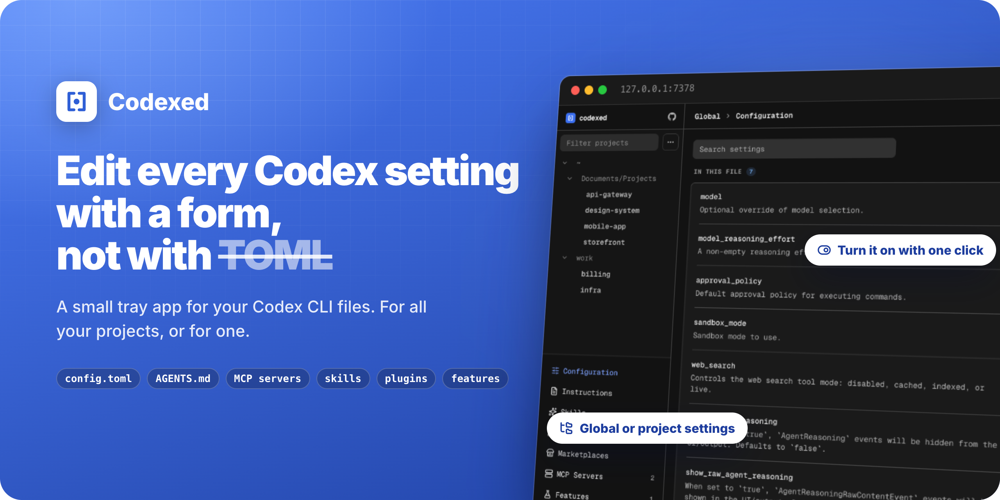

# Codexed



A tray app that manages your Codex CLI `config.toml`, `AGENTS.md`, skills, MCP servers, feature flags, plugins and marketplaces, globally and for each project folder. The interface runs in your browser at http://127.0.0.1:7378.

Codexed changes `config.toml` through Codex itself, so your comments and formatting stay, and Codex checks every value before it is saved.

## Install

```bash
curl -fsSL https://raw.githubusercontent.com/codex-config/codexed/main/install.sh | sh   # macOS, Linux
```

```powershell
irm https://raw.githubusercontent.com/codex-config/codexed/main/install.ps1 | iex   # Windows
```

See the [installation docs](https://codexconfig.com/docs/installation) for options and uninstalling.

## Layout

| Path              | What it is                                                                  |
| ----------------- | --------------------------------------------------------------------------- |
| `main.go`         | Entry point: flags, single instance check, HTTP server, tray                |
| `tray.go`         | Tray menu with Open, GitHub and Quit                                        |
| `icon.go`         | Tray icon, drawn at startup                                                 |
| `internal/codex`  | Finds Codex, talks to `codex app-server`, edits config files, lists projects |
| `internal/server` | JSON API under `/api` and checks on every request                           |
| `web`             | React, Vite and shadcn interface. `web/embed.go` embeds the build           |
| `docs`            | Landing page and docs, made with Fumadocs                                   |
| `packaging`       | Files for platform packages, such as the macOS `Info.plist`                 |
| `install.sh`      | Installer for macOS and Linux                                               |
| `install.ps1`     | Installer for Windows                                                       |

## How it talks to Codex

Codexed runs two `codex app-server` processes. One uses your real Codex home and answers questions such as which models, skills, plugins and feature flags exist. The other uses a scratch folder: to change a config file, Codexed copies the file there, lets Codex make the change, and writes the result back. That way the same TOML editor of Codex changes the user config and the project configs, which Codex itself does not write.

The list of settings comes from the config schema that each Codex release publishes. Codexed bundles one, and downloads the one for your Codex version once.

## Commands

```bash
make build    # web, then bin/codexed
make dev      # Go API on :7378 and Vite on :5173
make test     # go vet and go test
make app      # bin/Codexed.app for macOS (menu bar only)
make release  # release assets and checksums in bin/release
make docs     # docs dev server. cd docs && npm run build writes the static site to docs/out
make config-schema  # refresh the bundled config schema from your Codex
```

You need Go 1.26 or later, Node.js 24 or later, and the Codex CLI.

## Security

The server only listens on 127.0.0.1. It refuses requests with a different `Host` header, which blocks DNS rebinding. API requests must send an `X-Codexed` header. Browsers do not let other websites send that header, so they cannot change your files.

## License

[MIT](LICENSE)
